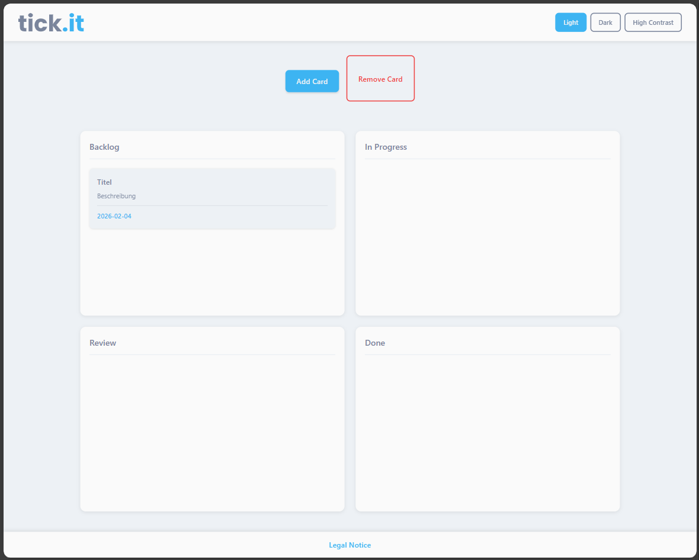

# tick.it - Webapp Kanban Board

tick.it ist eine webbasierte Kanban-Board-Anwendung zur Verwaltung von Aufgaben und Workflows. Die Anwendung ermöglicht es, Aufgaben als Karten zu erstellen, zu bearbeiten, zu verschieben und zu löschen.

### Funktionen:

- Erstellen, Bearbeiten und Löschen von Karten über ein Modal
- Drag-and-Drop zum Verschieben von Karten zwischen den Spalten
- Löschen von Karten per Drag-and-Drop 
- Unterstützung von drei Themes:
    - Light
    - Dark
    - High Contrast
- Fully Responsive-Design 
    - Mobile (<= 1080px)
    - Tablet (1081px bis 1919px)
    - Desktop (>= 1920px)   
- Reduced Motion Implementierung
- Speicherung der Daten über ein Backend mit REST-API

### Technischer Überblick:

| Komponente          | Technologie                          | Beschreibung                     |
|---------------------|--------------------------------------|----------------------------------|
| **Frontend**        | HTML, CSS, TypeScript                | Vanilla JS, keine Frameworks     |
| **Backend**         | Node.js mit Express                  | REST-API Server (Port 3001)      |
| **Datenhaltung**    | JSON-basierter Service               | json-server + db.json (Port 3002)|
| **Kommunikation**   | REST-API                             | GET, POST, PATCH, DELETE         |
| **State-Handling**  | Synchronisation zwischen UI & Backend| Lokales Array + API-Calls        |

## Dokumentation von KI-Einsatz
- Unterstützung in der Codegenerierung mit Claude Sonnet 4.5
- Fehlersuche mit Claude Sonnet 4.5
- "Side AI Hustle" Branch Styling und Modal Interface erstellt mit Claude Sonnet 4.5
